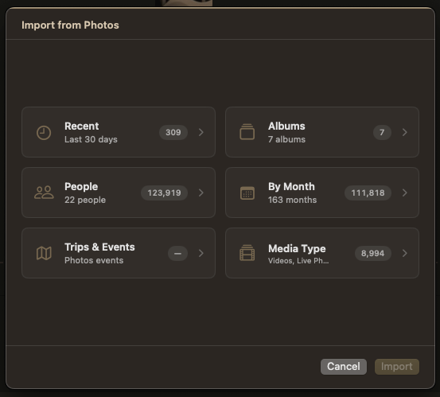

# MemoryString vs FotoMagico vs iMovie

Mac apps can turn photos into something you can watch. They solve different problems.

MemoryString is a free Mac slideshow app. Drop a folder of photos, pick a Look, export an MP4. FotoMagico targets live presentations and pro slideshow editing. iMovie is Apple’s video editor for manual cutting. Final Cut Pro is a pro video editor. CapCut is a social creator's app. Apple Photos Memories makes automatic movies. Photopia is dedicated slideshow software. This page compares them honestly. MemoryString is not a full replacement for every job.


**Get MemoryString free**: [Download MemoryString 1.2.7](https://github.com/zackypick/memorystring-downloads/releases/download/v1.2.7/MemoryString-1.2.7.dmg) (DMG installer, the newest version) or get it on the [Mac App Store](https://www.codebyz.com/api/go/memory-string-app-store?from=gitbook-compare). No account, no subscription. macOS 14 (Sonoma) or later, Apple Silicon and Intel.


**Your kids' faces are not training data.**

## Who holds your photos

As AI spreads, breaches will only get more common, and family photos are exactly what attackers want. Every cloud or AI slideshow service can be breached, and once photos are out they don't come back. A breach doesn't stop at the pictures: it takes the addresses in EXIF data, where each shot was taken, the dates, the people named in captions, a map of where your family actually is. MemoryString works differently: nothing is uploaded, no account is created, and no model ever sees your library.

## See it in action

Watch MemoryString turn a folder of photos into a movie.



More videos: [Your first movie](https://youtu.be/M9LE0RbdVtc) and [Eight Looks](https://youtu.be/KVsfmvt9duQ). All tutorials are on the [MemoryString YouTube channel](https://www.youtube.com/@MemoryStringApp). The product site is [memorystring.app](https://memorystring.app).

## Where each one sits

| | MemoryString | FotoMagico | iMovie |
| --- | --- | --- | --- |
| **Best for** | Camera roll → shareable movie tonight | Live stage shows, layers, clicker control | Timeline editing and a full cut |
| **Price** | Free | Paid subscription for the editor | Free with macOS |
| **Account** | None | License for the editor | Apple ID as usual |
| **Where it runs** | Your Mac: macOS 14+, Intel and Apple Silicon | Mac and iPad; live play without waiting on a render | Mac (and iOS) |
| **Camera-roll helpers** | [Keep Best Shots](../auto-detection.md#keep-best-shots) (extras in [Outtakes](../library.md#outtakes)), [Auto Trim](../auto-detection.md#auto-trim), mute | You cull and time the show | You cull and cut |
| **Big piles** | [Long story short](../long-story-short.md): pick a length (default 3 minutes, up to 30), best shots spread across the trip, the rest in Outtakes | You pick the shots | You pick the shots |
| **Music fit** | [Fit Show to Music](../music.md#length): the song covers the whole film, end card included | You time slides to the music | You trim to the music |
| **Photos.app** | [Import from Photos…](../library.md#import-from-photos): Recent, Albums, People, By Month, Trips & Events, Media Type | File-oriented import | iMovie can import from Photos too; MemoryString’s sheet is built for browsing albums and people |
| **Looks** | One-chip [Looks](../style/looks.md): whole-film style | Themes, layers, storytelling add-ons | Titles and effects you assemble |
| **Captions** | Landmark, city, country and date when you run Auto Caption (Studio picks which, and the language), never camera file names. Optional closing words on the end card | Titles you design | Titles you build |
| **Share** | [H.264 MP4](../export.md) on your Mac; [Social Safe](../export.md#social-safe); [Screensaver](../export.md#screensaver) for System Settings → Wallpaper | Live present plus video export | Share from the editor |
| **On-device** | Yes. Your folder stays on your Mac | Local editor; their cloud is for license and project sync | Local |

## FotoMagico still wins some rooms

If you present in a hall with a clicker, need iPad authoring, or want layers and live play without encoding first, FotoMagico fits that job. MemoryString always exports an H.264 MP4 on your Mac. That is a different workflow.

## iMovie is a longer editing session

iMovie lets you cut on a timeline with tracks and precise edits. MemoryString does not replace that. If you want a movie from a burst of similar photos for friends or family, MemoryString is built for that path.

## Final Cut Pro is for serious video work

Final Cut Pro is Apple's professional video editor for serious hobbyists and pros. Available on Mac and iPad with a one-time purchase on Mac, subscription on iPad. Very powerful for manual editing, but building a photo story means doing everything by hand: timing, motion, keyframes. MemoryString does that for you with [Looks](../style/looks.md) and automatic timing.

## CapCut targets short social videos

CapCut is ByteDance's free editor with paid Pro features, built for social creators making short vertical videos. Available on phones, desktop, and web. Template driven and cloud tied. MemoryString wins on local-first privacy and long photo stories with [Long story short](../long-story-short.md) handling trips up to 30 minutes.

## Apple Photos Memories is effortless but limited

Apple Photos Memories is the free automatic memory movie built into Apple Photos. Effortless but very little control over style, timing, or music. That control gap is what MemoryString fills: choose your own [Looks](../style/looks.md), [music](../music.md), [captions](../intro-captions.md), and shot selection with [Keep Best Shots](../auto-detection.md#keep-best-shots).

## Photopia is slideshow software

Photopia (Photopia Creator and Director) is slideshow software by former ProShow developers, the successor to ProShow which closed January 31, 2020. Available on Windows and Mac, and can import old ProShow shows and effects. A dedicated slideshow tool. MemoryString is free and local-first on Mac.

## Pro video editors are overkill

DaVinci Resolve and Premiere Pro are powerful professional video editors, but they are overkill for photo stories where MemoryString handles motion and timing automatically.

## MemoryString helpers, then export

[Keep Best Shots](../auto-detection.md#keep-best-shots) can keep the best frame from a near-duplicate burst. Import may ask when similar stills appear. Extras stay in the project as [Outtakes](../library.md#outtakes). [Auto Trim](../auto-detection.md#auto-trim) keeps about four seconds from the middle of a clip (with a small face nudge). You choose it from the menu, not on import.

[Import from Photos…](../library.md#import-from-photos) opens a dedicated sheet: Recent, Albums, People, By Month, Trips & Events, and Media Type, with a From / To date filter.

[Mute](../auto-detection.md#video-sound-auto-mute) can quiet wind, hiss, and room tone so music leads. Talking, music, and sharp hits stay. Sideways and upside-down photos and videos are [turned upright on import](../auto-detection.md#orientation). Original files stay as shot. [Center of interest](../auto-detection.md#center-of-interest) aims motion at faces. **Auto Caption** can fill place · date when you run it, not on import.

[Looks](../style/looks.md) restyle the whole film from one chip. [Export](../export.md) is H.264 MP4 on your Mac. [Social Safe](../export.md#social-safe) lets you compose in 16:9 and export a tall frame. **Screensaver** makes a silent looping file for System Settings → Wallpaper.

Every movie ends with a **Created with MemoryString** credit. There is no toggle to hide it. The app is free.

[Essential and Studio](../workspace/essential-studio.md) are two depths of the same app, not a paid tier. Looks, import, Keep Best Shots, Auto Trim, and export work in both.


**Keep Best Shots** may ask after import when similar stills show up. **Auto Trim** and **Auto Caption** run only when you choose them, not on import.


## Get it

[**Download MemoryString 1.2.7**](https://github.com/zackypick/memorystring-downloads/releases/download/v1.2.7/MemoryString-1.2.7.dmg) (DMG installer, free, the newest version) or get it on the [**Mac App Store**](https://www.codebyz.com/api/go/memory-string-app-store?from=gitbook-compare) (version 1.2.6, currently under review for 1.2.7). No account, no subscription. macOS 14 (Sonoma) or later, Apple Silicon and Intel.

New here? [Quick start](quick-start.md) gets you to a finished movie.
