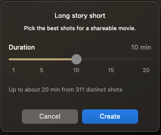

# Long story short

**Long story short** builds a movie you can actually share from a big pile of photos and videos. You pick the length. It picks the best shots and spreads them across the whole trip. Everything else goes to **Outtakes**. Nothing is deleted from your Mac.

## Start it

- **File → Long story short**
- **Library** Show menu → **Make Long story short**

The sheet is titled **Long story short**. Under that: **Pick the best shots for a shareable movie.** Choose a **Duration** from **1** to **30** minutes, then **Create**. The top stops at what the photos can actually fill. **Cancel** closes the sheet. The default is **3 min**, short enough to share. Next time the slider starts where you left it.

If the show already has slides, it asks first: **Rebuild the show?** **Continue** opens the Duration sheet. The show stays as it is behind the sheet. **Cancel** changes nothing. Only **Create** rebuilds.

While the sheet looks through the photos it says **Checking M of N photos…**. When that count is ready, the line under the slider reads **Up to about N min from M distinct shots**. The offer is the nearest minute that show can actually reach. The finished movie lands within about 10 seconds of the minute you pick.

## Large imports

When an import would put more than **150** photos and videos on the show, MemoryString asks first: **That would make a N-photo show**.

- **Long story short** — pick the best ones for a shareable movie
- **Import all** — put everything on the show
- **Cancel** — import nothing

Same on every import path: **+**, Finder drop, **Import from Photos…**, Photos.app drag, folders, and paste.

## What it picks

- **Sharp, well-exposed** photos. Blurry, very dark, and tiny files are skipped
- **Near-duplicates** stay out. A different pose stays in. At most two shots from one pose, and those are not placed side by side
- **One group per shoot.** Photos from the same moment stay together. A two-shot series does not have to be a **Perspective Pair**. **Auto** may still pick Pair as one of the kinds. Uncheck Pair and those shots become single slides, with another slide between them when there is room. Pair stays off after **Shuffle**, a length change, reopening the project, and clicking the **Look** again
- **The whole trip**, not just the best day. Shots are spread across your dates
- **Videos** too. Each one is cut with [Auto Trim](auto-detection.md#auto-trim)

The show plays in date order. The length lands within about 10 seconds of the minute you picked.

While it works you may see **Making a long story short...**, **Checking M of N photos…**, **Picking the best shots...**, **Reviewing M of N...**, **Straightening M of N...**, **Arranging N shots…**, and **Finding focus M of N…**. While it fits the length, the line shows the clock so far, such as **2:23 of 10:00**. Kept shots are upright before the movie is laid out. Focus lands on a face, not the middle of the frame. After **Importing** and **Finding focus** finish, the show comes up — it does not sit on that last count. **Cancel** on the Duration sheet changes nothing. **Cancel** while it is building puts the previous show back. See [Orientation](auto-detection.md#orientation).

**Add**, **+**, Import Media, Import from Photos, Music, and drops stay grey until Long story short finishes — including Close, Open, and Cancel. Hover: **Wait until Long story short finishes**.

## After it runs

- Groups are dealt across the finished show, the same way **Shuffle** does, with the usual gap between them, not back to back
- The title bar shows the new length
- Close the project and open it again: the same order, the same length
- Shots that did not make it are in [Outtakes](library.md#outtakes). Drag any of them up to put them back
- A show you already styled keeps its **Look** and soundtrack. If the new cut runs longer than your music, bundled songs fill the rest. Your own tracks are never replaced
- A brand-new project starts on **Clean**, on the **Light** stage, with bundled music
- Undo with **⌘Z**

Run it again anytime with a different length. It chooses from everything in the project, **Outtakes** included.
