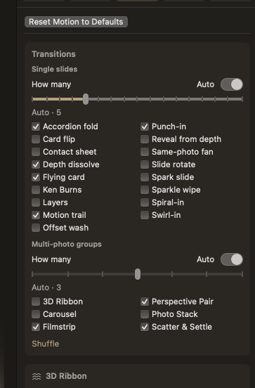

# Transitions

Transitions control how each photo enters and leaves. In **Studio**, open Inspector → **Motion** → **Transitions**.

The checked boxes are the kinds this show uses. They match the timeline, including groups you pinned. A new show starts with a short list that grows with the number of photos. A show you already saved keeps the list it had.

## How many

**Single slides** and **Multi-photo groups** each have a **How many** slider and an **Auto** switch.

**Auto** follows how many photos are in the show:

| Photos | Single-slide transitions | Group kinds |
| --- | --- | --- |
| Up to about 12 | 2 | 1 |
| About 13 to 30 | 3 | 2 |
| About 31 to 60 | 4 | 3 |
| Longer | 5 | 3 |

Drag **How many** and **Auto** turns off. The line under the slider reads **Auto · 2** or **Custom · 3**, and the show re-cuts to that many kinds. Check or uncheck a kind and the show re-cuts the same way. The line says **Custom**.

**Shuffle** keeps the kinds you checked by hand and redraws the rest, then cuts the show again.

Set group **How many** to **0** for a show with no multi-photo groups.

Each of these is one undo (**⌘Z**).

At least one single-slide transition stays on. Option-click a single-slide row to use only that one.

**Reset Motion to Defaults** puts both **How many** controls back on **Auto** and restores this Look's motion settings. Slide order and durations stay.

Clicking a **Look** deals a fresh short list for that Look. A group kind you turned off, such as **Perspective Pair**, stays off. Check it again to bring it back. See [Looks](../style/looks.md#the-eight-chips). Energy does not turn a checked kind off.

## Single slides

One photo at a time. At least **one** transition type stays on. MemoryString has **17** single-slide types. A show uses the ones that are checked.

### Ken Burns

Slow zoom toward the focus point.



### Depth dissolve

Photo sharpens from blur.



### Layers

Outgoing photo fades while the next appears.



### Card flip

Card flips in and out.



### Slide rotate

Card slides in from off-screen and slides out.



### Spark slide

Card slides with a spark trail.



### Sparkle wipe

Glitter trail as the next photo arrives.



### Flying card

Card moves through 3D space.



### Offset wash

Photo on one side, color wash on the other.



### Punch-in

Fast zoom through the frame.



### Spiral-in

Card spirals in; wash zooms.



### Reveal from depth

Photo pushes forward out of blur.



### Accordion fold

Fold animation in and out.



### Contact sheet

One sharp photo on a dim grid of the same image.



### Same-photo fan

One photo with soft side copies.



### Motion trail

Photo moves with a motion echo.



### Swirl-in

Card spirals in and out.



**Spiral-in** and **Reveal from depth** wind in slowly, so their slides run a little longer than the rest. They play at every **Energy**. Captions wait until the photo nearly lands.

Per-slide pick: right-click → **Slide Transition** (includes **Random**). See [Library](../library.md#right-click-a-slide).

## Multi-photo

Several photos in one beat — **3D Ribbon, Carousel, Filmstrip, Perspective Pair, Photo Stack, Scatter & Settle**.

Checked kinds are the ones this show groups with. You can check every kind. A short show does not turn a box back off. **Auto** still picks a short list from the length of the show, and never more than four kinds. **How many** at **0** leaves one photo at a time.

**Perspective Pair** is not forced. **Auto** may still pick it as one of the kinds. Uncheck it and those pairs become single slides. When there is room, another slide sits between the two shots. It stays off after **Shuffle**, a length change, reopening the project, and clicking the **Look** again. Check it to bring the pairs back. **⌘Z** restores them.

Details: [Multi-photo groups](groups.md).
